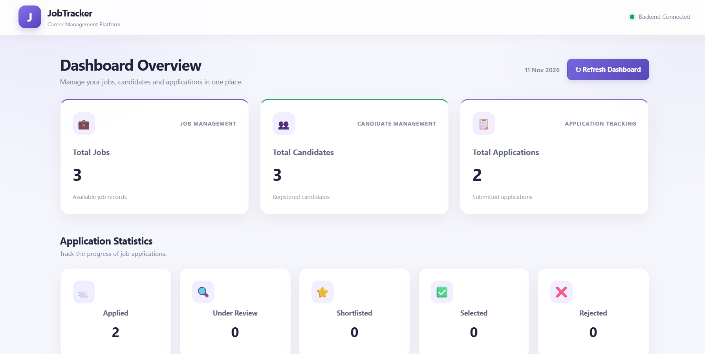
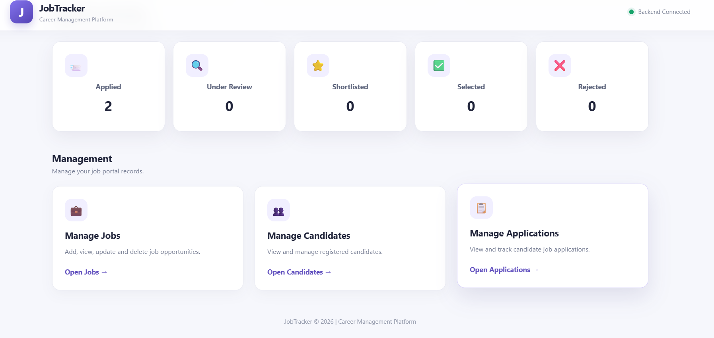

# 🚀 JobTracker – Career Management Platform

A full-stack web application designed to manage job opportunities, candidate information, and job applications in one place.

🔗 **Live Website:** https://jobtracker-mu-eosin.vercel.app/  
💻 **GitHub Repository:** https://github.com/NemalikondaUmesh/JobTracker

## ✨ Features

### 📊 Dashboard
- Overview of total jobs, candidates, and applications.
- Application status statistics.
- Quick access to all management sections.

### 💼 Job Management
- Add new job opportunities.
- View all available jobs.
- Update job details.
- Delete jobs.
- Manage job information such as company, location, salary, and required skills.

### 👨‍💻 Candidate Management
- Register new candidates.
- View candidate profiles.
- Update candidate information.
- Search candidates by name or email.
- Manage phone numbers, email addresses, and skills.

### 📋 Application Management
- Apply candidates to available jobs.
- View application records.
- Track application statuses.
- Update application status.
- Delete applications.

## 🛠️ Technologies Used

| Category | Technologies |
|---|---|
| Backend | Java 17, Spring Boot |
| Frontend | HTML5, CSS3, JavaScript |
| Database | PostgreSQL |
| ORM | Spring Data JPA, Hibernate |
| Build Tool | Maven |
| API Testing | Postman |
| Version Control | Git, GitHub |
| Frontend Deployment | Vercel |
| Backend Deployment | Render |

## 🏗️ Project Structure

```text
JobTracker/
├── src/
│   ├── main/
│   │   ├── java/com/alpha/JobTracker/
│   │   │   ├── controller/
│   │   │   ├── entity/
│   │   │   ├── exception/
│   │   │   ├── repository/
│   │   │   ├── requestdto/
│   │   │   ├── responsedto/
│   │   │   └── service/
│   │   │
│   │   └── resources/
│   │       ├── static/Frontend/
│   │       │   ├── css/
│   │       │   ├── Js/
│   │       │   ├── index.html
│   │       │   ├── jobs.html
│   │       │   ├── candidates.html
│   │       │   └── applications.html
│   │       └── application.properties
│   └── test/
├── pom.xml
└── README.md
```

## ⚙️ Run Locally

### Prerequisites
- Java JDK 17 or later
- Maven
- PostgreSQL
- Eclipse IDE or another Java IDE

### 1. Clone the repository

```bash
git clone https://github.com/NemalikondaUmesh/JobTracker.git
cd JobTracker
```

### 2. Configure PostgreSQL

Create a PostgreSQL database named `jobtracker`.

Configure your database connection in `src/main/resources/application.properties`:

```properties
spring.datasource.url=jdbc:postgresql://localhost:5432/jobtracker
spring.datasource.username=postgres
spring.datasource.password=YOUR_PASSWORD

spring.jpa.hibernate.ddl-auto=update
spring.jpa.show-sql=true

server.port=8080
```

Replace `YOUR_PASSWORD` with your local PostgreSQL password.

### 3. Run the application

Using Maven:

```bash
mvn spring-boot:run
```

Or run `JobTrackerApplication.java` from Eclipse.

### 4. Open the application

```text
http://localhost:8080/Frontend/index.html
```

## 🔌 API Endpoints

| Method | Endpoint | Description |
|---|---|---|
| GET | `/job/all` | Retrieve all jobs |
| POST | `/job/add` | Add a job |
| PUT | `/job/update/{id}` | Update a job |
| DELETE | `/job/{id}` | Delete a job |
| GET | `/candidate/all` | Retrieve candidates |
| POST | `/candidate/register` | Register candidate |
| PUT | `/candidate/update/{id}` | Update candidate |
| DELETE | `/candidate/{id}` | Delete candidate |
| GET | `/job/applications` | Retrieve applications |
| POST | `/job/apply` | Apply for a job |
| PUT | `/job/application/status/{id}` | Update application status |
| DELETE | `/job/application/{id}` | Delete application |


## 📸 Application Screenshots

### 1. Dashboard


### 2. Dashboard Statistics


### 3. Jobs Management


### 4. Applications Management


### 5. Candidate Registration


## 🌐 Deployment

- **Frontend:** Vercel
- **Backend:** Render
- **Database:** PostgreSQL

## 🎯 Project Objective

The objective of JobTracker is to simplify career and recruitment management by providing a centralized platform for managing job opportunities, candidate records, and application progress.

## 👨‍💻 Developer

**Nemalikonda Umesh**

- GitHub: https://github.com/NemalikondaUmesh

---

⭐ If you find this project useful, consider giving the repository a star.
